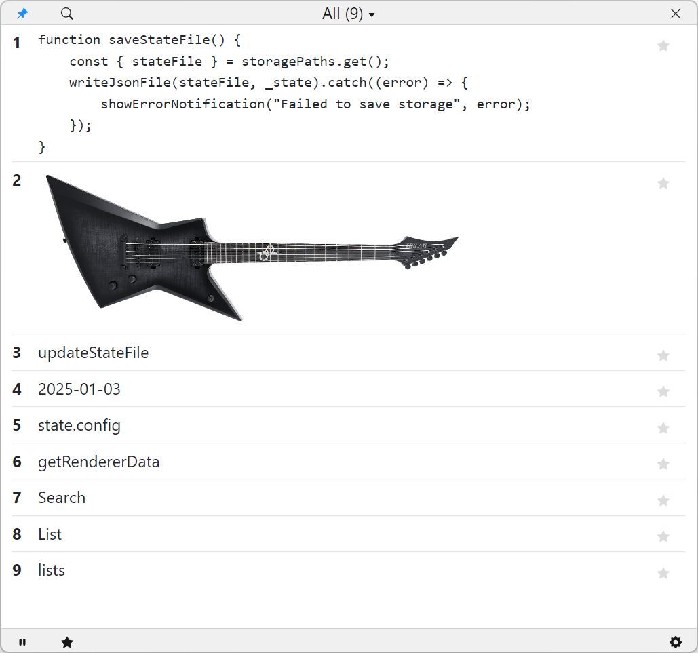

# Clippy

Clipboard manager with RPC. Support keyboard, mouse and excellent Talon Voice integration.

## Download latest release

- [Windows](https://github.com/AndreasArvidsson/clippy/releases/latest/download/Clippy-Windows.zip)
- [Linux](https://github.com/AndreasArvidsson/clippy/releases/latest/download/Clippy-Linux.zip)
- [macOS](https://github.com/AndreasArvidsson/clippy/releases/latest/download/Clippy-macOS.zip)

For more details read the [installation and uninstallation instructions](./INSTALLATION.md).

## Privacy policy

Clippy stores clipboard data as JSON files in the `clipboardItems` folder within its local application data directory on your computer. It does not upload this data or include analytics, telemetry, or automatic crash reporting. The released application loads its interface and assets locally and does not require an internet connection.

## Talon user scripts

If you are going to use Clippy together with Talon you need the Talon user scripts.

[Clippy Talon](https://github.com/AndreasArvidsson/clippy-talon)

## User guide

### Keyboard and mouse control

#### Show / hide Clippy

- Keyboard (Win): Press `Win+Alt+C`
- Keyboard (Mac): Press `Cmd+Alt+C`

#### Copy items

- Mouse: Left click on item
- Keyboard: Press corresponding number or letter key
- Keyboard: Press `enter` to copy all selected items

#### Remove items

- Right click on item and select `"Remove item"` to remove all selected items
- Press `delete` key to remove all selected items

#### Rename items

- Right click and select `"Rename item"` to rename selected item
- Press `F2` key to rename selected item

#### Star / move items to list

Items in a list will not be removed automatically when the size limit is reached.

- Left click star icon to move item to list `"My favorites"`
    - Clicking on a already starred item will remove it from its list
- Right click and select `"Move item"` to move all selected items
- Enable `Auto star` to automatically star new clipboard items

#### Select multiple items

- Pres `Control` key and left click with mouse to select or deselect item
- Pres `Control` key and corresponding number or letter or deselect item
- Once you have at least one item selected you don't have to use control
    - Just directly click with mouse or keyboard to select additional items
- Press `Escape` key to remove all selections

### Talon / voice control

The Talon voice commands are documented in the [Clippy Talon](https://github.com/AndreasArvidsson/clippy-talon) repository.

[Available RPC commands](./src/types/command.ts)

## Run source code

```
$ npm install
$ npm start
```

## Package app from source code

Creates `dist` directory with executable

```
$ npm install
$ npm run package
```

## Images


